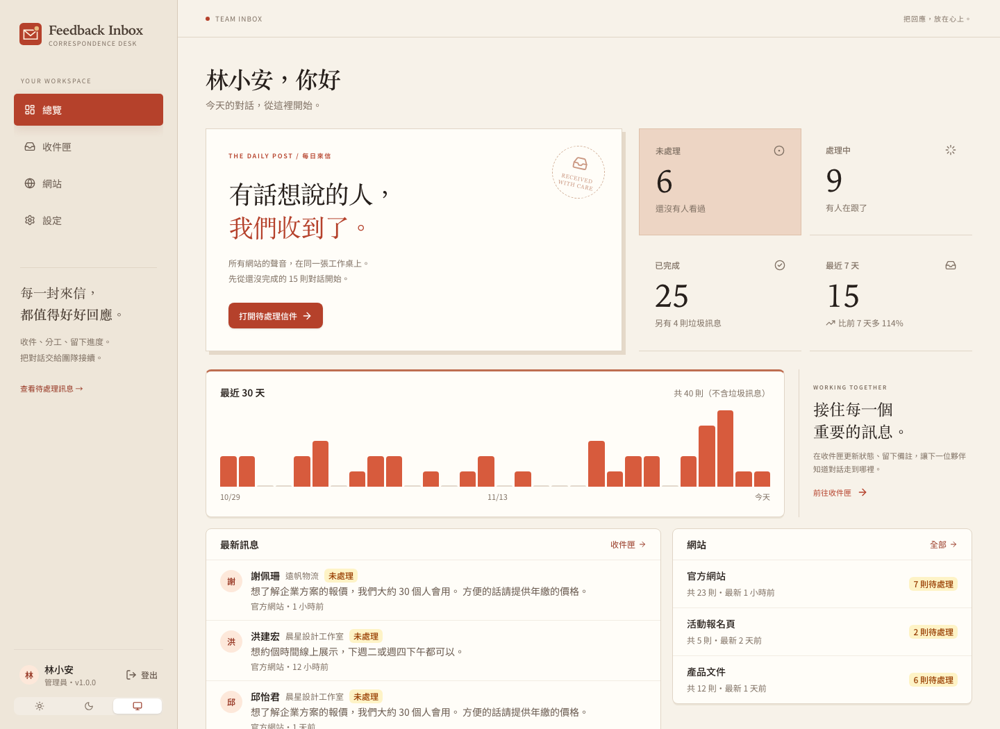
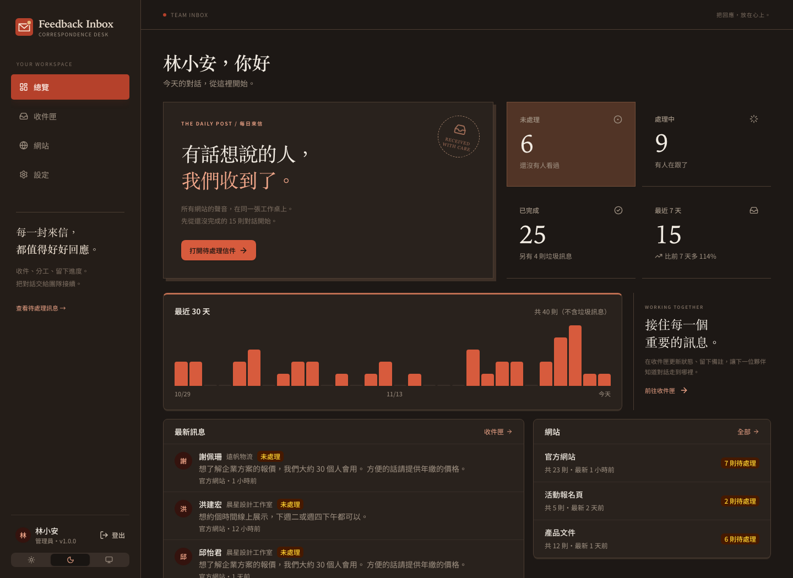

<p align="center">
  
</p>

<p align="center">
  <a href="https://github.com/NatLee/feedback-inbox/actions/workflows/ci.yml"></a>
  
  
  
  
</p>

網站上的「聯絡我們」表單，送出之後通常是寄一封信到某個共用信箱，然後就沒有然後了：誰看過、誰回了、哪幾則還沒人理，都不知道。

Feedback Inbox 是這些表單的後端和收件匣。把表單的 `action` 指到它給的網址，訊息就會進來；每個網站可以指定負責人，有新訊息時寄信或送到 Slack / Discord；每一則訊息有狀態和處理紀錄，總覽頁看得到還有幾則沒處理。

一個 Docker 映像檔就是全部：Rust 後端、React 前端、SQLite 資料庫。

<p align="center">
  <picture>
    <source media="(prefers-color-scheme: dark)" srcset="docs/images/screenshot-inbox-dark.png">
    
  </picture>
</p>

## 功能

- **一個網址就能收表單**：一般的 HTML 表單和 `fetch` 送的 JSON 都收，不用在自己的網站寫後端。也有一張現成的表單頁，沒有網頁時直接把連結給人填。
- **多個網站**：每個網站有自己的表單網址、必填欄位、負責人和通知方式。成員只看得到自己負責的網站。
- **通知**：寄信給負責人（直接按「回覆」就是回給留言的人），以及 webhook。Slack 和 Discord 的 webhook 網址會自動用它們的格式，其他網址收到完整的 JSON。每一則通知有沒有送出去都查得到。
- **處理流程**：未處理 → 處理中 → 已完成，或標成垃圾訊息。可以寫備註給同事看，誰在什麼時候改了狀態都留著。
- **擋垃圾訊息**：藏起來的欄位（honeypot）、同一個 IP 的次數限制、限定只收哪些網站送來的表單。
- **搜尋、篩選、整批處理、CSV 匯出**，以及總覽頁：各狀態的數量、最近 30 天每天幾則、每個網站還有幾則待處理。
- **帳號**：第一個打開網頁的人建立管理員，沒有預設帳號，也沒有預設密碼。密碼用 Argon2 雜湊，登入是 HttpOnly cookie。
- 淺色和深色模式。

## 畫面與工作流程

以暖紙色、赤陶紅與信件工作桌為主題，固定的收件側欄讓團隊在總覽、收件匣和網站設定間移動。所有數字來自 API；截圖使用專案內建的虛構 demo 資料。

### 今日工作桌

總覽先顯示待處理對話的入口，再看未處理／處理中／已完成數量、來信趨勢和最新訊息。



### 閱讀與接續對話

信件式內容頁保留聯絡方式、狀態選單、備註、通知結果及時間紀錄。列表提供狀態分頁、搜尋、日期篩選、整批處理及 CSV 匯出。


### 網站與成員

每個網站分別設定表單欄位、來源限制、負責人與通知方式。


<details>
<summary>登入、深色與手機畫面</summary>





</details>

## 快速開始

```bash
git clone https://github.com/NatLee/feedback-inbox.git
cd feedback-inbox
docker compose up -d --build
```

打開 <http://localhost:8787>，第一次會請你建立管理員帳號。接著：

1. 到「網站」新增一個網站，會拿到一個表單網址。
2. 把它貼進表單的 `action`：

   ```html
   <form action="http://localhost:8787/f/你的表單代碼" method="post">
     <input name="name" placeholder="姓名" required>
     <input name="email" type="email" placeholder="電子信箱" required>
     <textarea name="message" placeholder="想說的話" required></textarea>
     <!-- 人看不到、機器人會填的欄位：有填就當成垃圾訊息 -->
     <input name="_gotcha" style="display:none" tabindex="-1" autocomplete="off">
     <button>送出</button>
   </form>
   ```

   認得的欄位是 `name`、`email`、`phone`、`company`、`message`，其他欄位會原樣留在訊息裡。用 `fetch` 送 JSON 也可以，網站設定頁有寫法。
3. 送一則試試，它會出現在收件匣。

想先看有資料的樣子，可以在**空的**資料庫裡建立範例帳號、網站和訊息（密碼會印在畫面上）：

```bash
docker compose run --rm feedback-inbox feedback-inbox demo
```

忘記密碼的時候：

```bash
docker compose exec feedback-inbox feedback-inbox reset-password <帳號>
```

### 通知信

寄信需要一個 SMTP 服務，在 `.env` 裡設定（[.env.example](.env.example) 有範例）；沒設定就不寄信，webhook 不受影響。收信的是網站的負責人，信箱在各自的「設定」裡填。

還沒有 SMTP 的話，可以先用內附的假信箱看信長什麼樣子：

```bash
cat >> .env <<'ENV'
FI_SMTP_HOST=mailpit
FI_SMTP_PORT=1025
FI_SMTP_TLS=none
FI_SMTP_FROM=Feedback Inbox <inbox@example.com>
ENV
docker compose --profile mail up -d
```

寄出去的信都會出現在 <http://localhost:8025>，不會真的寄到任何人的信箱。網站設定頁的「送測試通知」可以馬上試。

### 放到網路上

前面放一個有 HTTPS 的反向代理（Caddy、nginx…），然後設定：

- `FI_PUBLIC_URL`：外部看到的網址。表單網址和通知信裡的連結用它組，是 https 時登入 cookie 會加 `Secure`。
- `FI_TRUST_PROXY=true`：訪客的 IP 才會是對的（次數限制是照 IP 算的）。
- 每個網站的「允許的來源」填上自己的網址，別的網站就不能拿你的表單網址來送。

## 設定

都是環境變數，全部可以不設。用 docker compose 時寫在同一個資料夾的 `.env`。

| 變數 | 預設 | 說明 |
|---|---|---|
| `FI_PORT` | `8787` | docker compose 對外的 port |
| `FI_PUBLIC_URL` | | 外部看到的網址，例如 `https://inbox.example.com` |
| `FI_COOKIE_SECURE` | 看 `FI_PUBLIC_URL` | `true` / `false`，強制指定 cookie 要不要加 `Secure` |
| `FI_TRUST_PROXY` | `false` | 前面有反向代理時設 `true`，訪客的 IP 改看 `X-Forwarded-For` |
| `FI_RATE_LIMIT` | `10` | 同一個 IP 一分鐘最多送幾次表單，`0` 是不限制 |
| `FI_SMTP_HOST` | | SMTP 伺服器。沒設就不寄通知信 |
| `FI_SMTP_PORT` | 看 `FI_SMTP_TLS` | `starttls` 是 587、`tls` 是 465、`none` 是 25 |
| `FI_SMTP_USERNAME`、`FI_SMTP_PASSWORD` | | SMTP 的帳號密碼 |
| `FI_SMTP_FROM` | | 寄件人，例如 `Feedback Inbox <inbox@example.com>`。設了 `FI_SMTP_HOST` 就要設 |
| `FI_SMTP_TLS` | `starttls` | `starttls`、`tls` 或 `none` |
| `FI_BIND` | `0.0.0.0:8787` | 伺服器聽的位址 |
| `FI_DATA_DIR` | `data`（映像檔裡是 `/app/data`） | 放 SQLite 資料庫的資料夾 |
| `FI_DATABASE_PATH` | `<FI_DATA_DIR>/feedback-inbox.db` | 資料庫檔案 |
| `FI_STATIC_DIR` | `src/web/dist`（映像檔裡是 `/app/web`） | 前端檔案的位置 |

資料都在 `feedback-inbox-data` 這個 volume 的 SQLite 檔案裡，備份那個檔案就好。

## 開發

需要 Rust（stable）、Node 24、pnpm。

```bash
# 後端：http://127.0.0.1:8787
cd src/api && cargo run

# 前端：http://localhost:5173，/api 和 /f 會轉給後端
cd src/web && pnpm install && pnpm dev
```

```bash
cd src/api && cargo fmt --check && cargo clippy --all-targets -- -D warnings && cargo test
cd src/web && pnpm test && pnpm build
bash docs/smoke-test.sh http://127.0.0.1:8787   # 對一個空的執行個體跑一輪
```

API 和 webhook 的格式在 [docs/api.md](docs/api.md)。

## 設計與驗證

[設計與實作紀錄](docs/design.md) 說明版型、響應式、後端修正及驗證範圍。封面是可編輯的 [SVG](docs/images/cover.svg)；應用畫面由 [擷取腳本](docs/capture-screenshots.py) 對隔離的 demo 執行個體重拍。

## 授權

[MIT](LICENSE) © Nat Lee
