# Forms and AI workflow verification

The feature is exercised on an owned disposable Compose project, with synthetic visitors, a deterministic local Ollama-protocol fixture, and Mailpit. No paid model calls, real customer messages, or user production databases are used. The fixture proves application/protocol wiring and state transitions; it does **not** establish a real model's factual accuracy, prompt-injection resistance, or provider/model availability.

## Source checks

Source checkpoint: `179193f` (forms/providers/workflows/UI plus current historical-field export restrictions, keyboard approval focus, immutable confirmation snapshots and active-account gates). Relevant prior checkpoints are `6244c31`, `a15b8da`, `0459cbd`, `fdf89d9`. The public generic `crates/ai-kit` remains isolated from FI tables/prompts/policies, unchanged since `6244c31`.

Run from the repository root:

```sh
export CARGO_TARGET_DIR=/tmp/registration-rust-target
export CARGO_BUILD_JOBS=2 CARGO_PROFILE_DEV_DEBUG=0 CARGO_PROFILE_TEST_DEBUG=0
cargo fmt --manifest-path src/api/Cargo.toml --check
cargo clippy --manifest-path src/api/Cargo.toml --all-targets -- -D warnings
cargo test --manifest-path src/api/Cargo.toml
cargo fmt --manifest-path crates/ai-kit/Cargo.toml --check
cargo clippy --manifest-path crates/ai-kit/Cargo.toml --all-targets -- -D warnings
cargo test --manifest-path crates/ai-kit/Cargo.toml
npm --prefix src/web test -- --run --maxWorkers=2
npm --prefix src/web run build
```

Fresh source results: 80 API tests, 58 frontend tests, strict Clippy and production TypeScript/Vite build pass. Provider protocol tests are run separately in ai-kit (6 tests). The existing auth/registration/access/read-only MCP suites remain included.

Focused regressions cover immutable publication and optimistic duplicate-publish conflict; legacy migration; typed/custom fields; CORS versus iframe policy; diagnostic limits; signed identity replay/site/expiry; secret encryption and atomic re-encryption rollback; competing claims/global concurrency/expired-token fencing; exact redacted Unicode evidence and approved knowledge references; authority, registration state, policy, source, knowledge, provider and current field-permission changes before inference and during an in-flight response; exact draft revisions/approval idempotency; revoked reviewer; automatic signed-member/consent/recipient quota; pause before transmission, resume high-water mark, retired template; SMTP acceptance versus ambiguous result; recovery before versus after the transmission boundary. UI checks cover secret retention, explicit configuration, actual diagnostic receipts, unsaved human draft preservation, explicit immutable confirmation snapshots and unknown-delivery display. Approval keyboard focus containment and restoration have a regression test.

These are targeted application checks, not a claim of exhaustive fault injection across every network or external provider behavior. A failed lease/recovery test and a duplicate-publication test were observed before their fixes; current-field restriction and approval keyboard regression tests likewise failed before the fixes.

Independent review also covered current authority and tenant visibility, identity/idempotency, credential boundaries, approved-template eligibility, SMTP claim/recovery, and preview revision changes. Review tests exposed an inactive-account authority gap before its fix; the final recheck passed.

## Disposable Compose and real browser

[compose.forms-ai-test.yml](compose.forms-ai-test.yml) overrides container/image names and publishes only loopback app `18987` and Mailpit `18025`. The local model fixture is network-internal, with a fixed encryption key clearly restricted to this fixture. Keep it out of production deployments.

```sh
docker compose -p feedback-workflow -f docker-compose.yml -f docs/compose.forms-ai-test.yml --profile mail build
docker compose -p feedback-workflow -f docker-compose.yml -f docs/compose.forms-ai-test.yml --profile mail up -d --no-build
FI_DISPOSABLE_WORKFLOW_TEST=true python docs/verify-forms-ai.py
FI_DISPOSABLE_WORKFLOW_TEST=true python docs/verify-forms-ai-restart.py
```

The Python environment must contain Playwright and a Chromium installation; `PLAYWRIGHT_CHANNEL` defaults to `chrome`. These scripts launch isolated headless test contexts against the owned development fixture. They do not operate a user's Chrome profile. The main test requires the fixture deployment's exact Ollama origin and deployment gate before seeding; it uses documented synthetic credentials only for this disposable database.

The browser script exercises real builder publication, hosted form submission, fixture analysis and redacted evidence, classification without status changes, edited reply save, exact-recipient confirmation with keyboard focus, and SMTP acceptance. It then enables future automatic generation/template sending in the UI, signs one verified member assertion from the fixture backend, and observes an automatic Mailpit reply. Identical intake retry produces no extra mail. Staff and visitor destinations are checked separately.

Separate HTTP origins `19088` and `19089` exercise genuine browser CORS: allowed-origin invalid JSON submission is readable, allowed valid synthetic submission produces an actual receipt, and a disallowed origin cannot read/send through the permission gate. The iframe completes inside its frame. Response checks prove scoped embed CSP and admin `X-Frame-Options: DENY`. Integration receipt polling, provider configuration view, review queue, 390px light/dark layouts, horizontal overflow and page errors are checked.

The restart script deliberately persists synthetic `running` analysis and `sending` reply crash states into the **stopped disposable** database, restarts the real API process, and checks safe analysis recovery versus `delivery_unknown` with no added Mailpit messages. This is not represented as interrupting a real SMTP transaction mid-DATA; a separate scripted SMTP test drops the connection after DATA and proves the ambiguity path.

Machine-readable receipts are [container results](forms-ai-container-results.json), [browser results](forms-ai-browser-results.json), and [restart results](forms-ai-restart-results.json). Each records IDs/counts from the actual run; screenshots below are real UI with fixture inference and synthetic data.

## Final rebuilt-image receipt

On 2026-11-28 (Asia/Taipei), runtime, nginx/frontend, and standalone targets built from `179193f`. Runtime and standalone both ran as UID 10001; the Compose API had no published host port. Nginx and standalone each returned 200 for `/healthz`, `/api/auth/state`, and the `/inbox` SPA deep link. The standalone smoke database used a disposable tmpfs.

The final browser run started with an empty Compose database: site 1, human feedback 1, automatic feedback 2. Mailpit received exactly one human customer reply, one automatic customer reply, and two staff notifications before the iframe submission. The iframe added its expected staff notification. No page JavaScript errors or horizontal overflow were observed. The restart test recovered analysis job 8 on attempt 2 and kept reply job 9 at attempt 1 with `delivery_unknown`; Mailpit stayed at **5 → 5** messages.

[GitHub Actions run 46052499597](https://github.com/NatLee/feedback-inbox/actions/runs/46052499597) independently passed the API, Web, and Docker jobs for `179193f`. Container hashes and UTC verification time are retained in the container receipt. Actual screenshots and the editable cover were visually inspected. These receipts cover the shipped application source; the final follow-up commit contains documentation, test harnesses, and images only.

The owned Compose app/model/Mailpit containers, fixture volume/network, standalone smoke container/tmpfs, and obsolete task-owned images were removed after verification. Shared build caches and other projects were left intact.

## Cover and screenshots

The [editable SVG cover](images/forms-ai-cover.svg) illustrates hosted/custom forms → evidence and exact-version human review → customer correspondence. Its fixed-template branch states identity, consent, unique-rule and quota requirements. It is an illustration, not a screenshot or delivery receipt. Actual application captures follow.

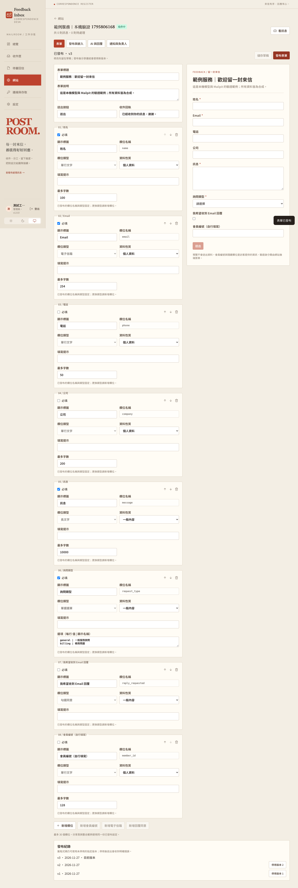
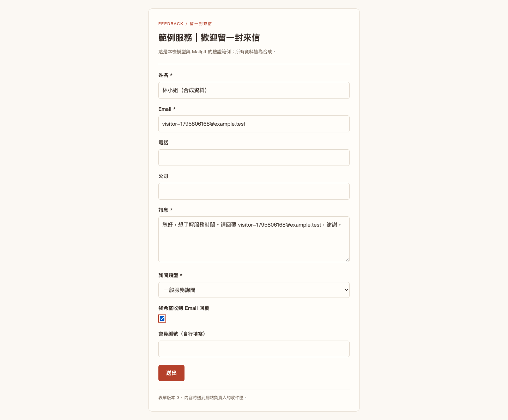
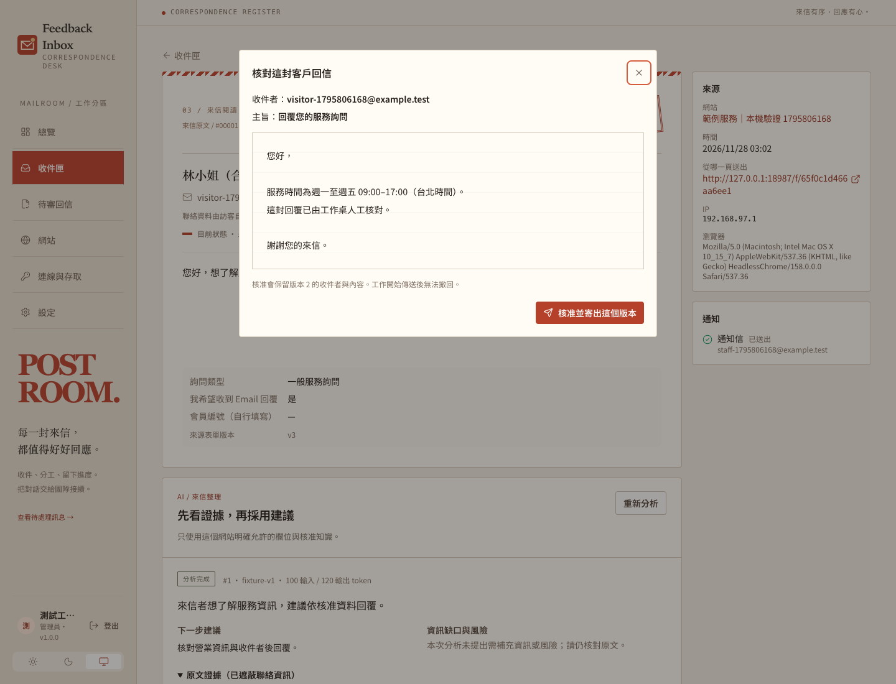
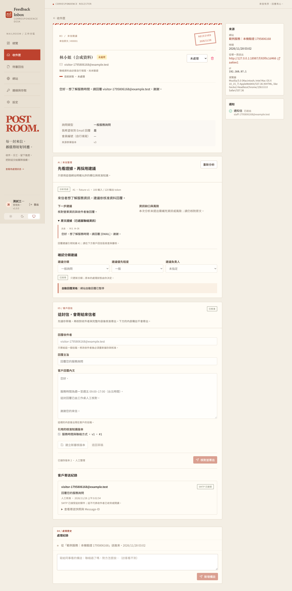
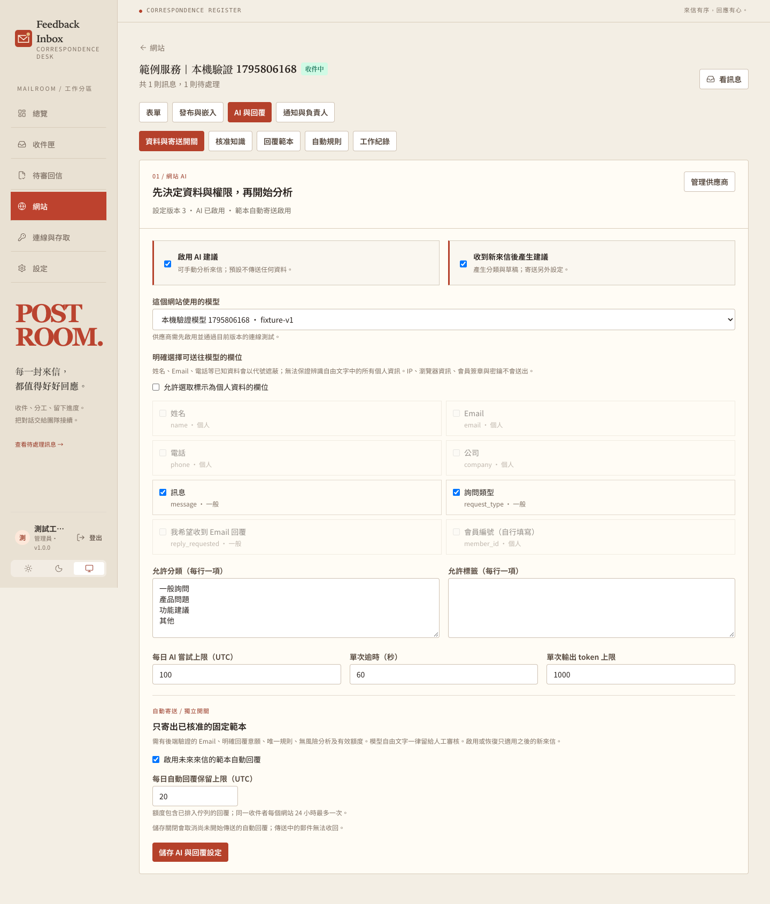
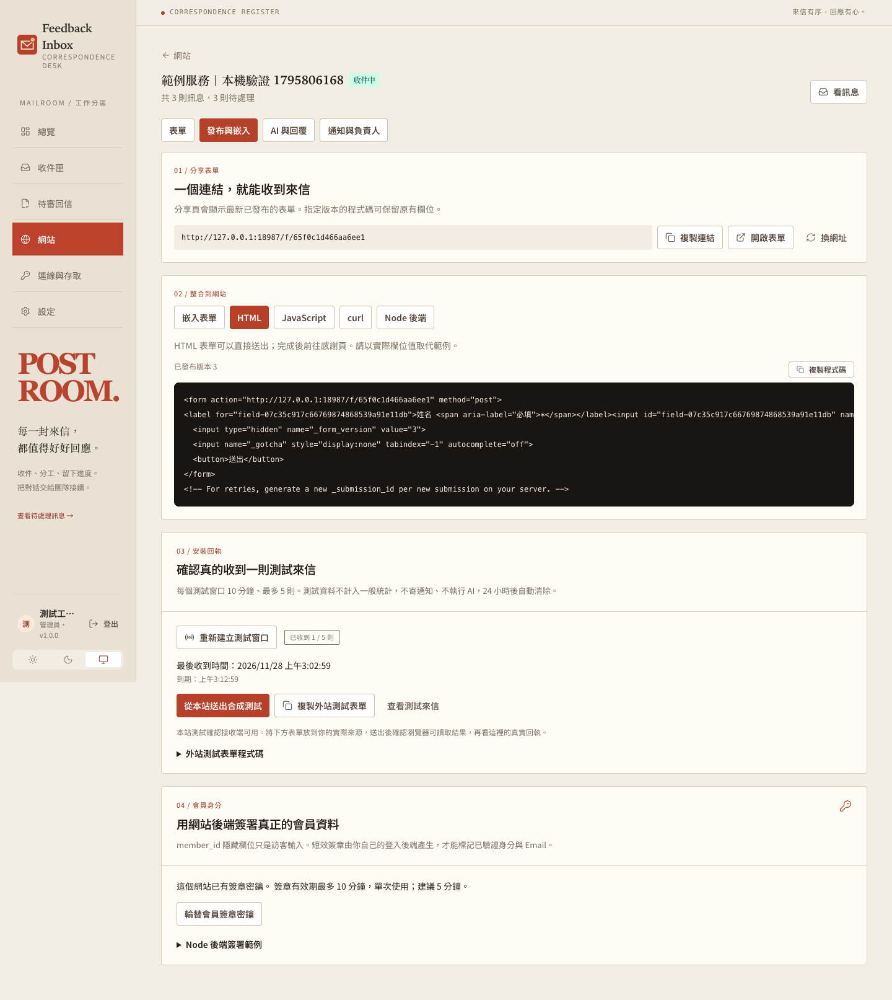
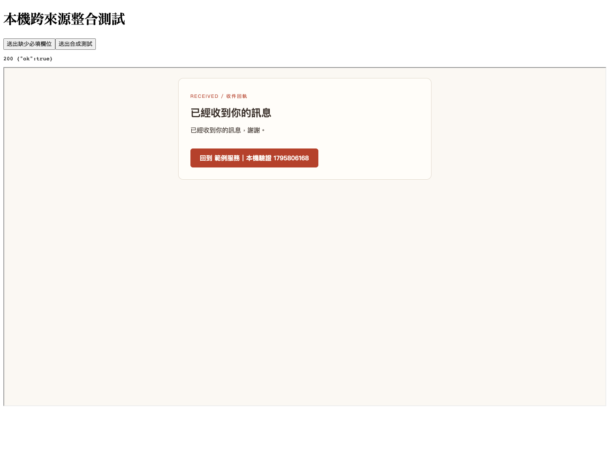
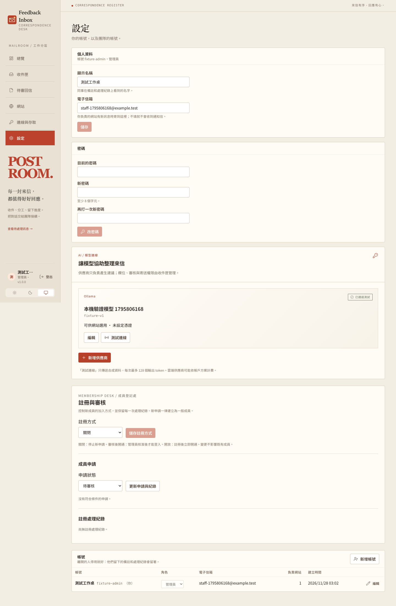
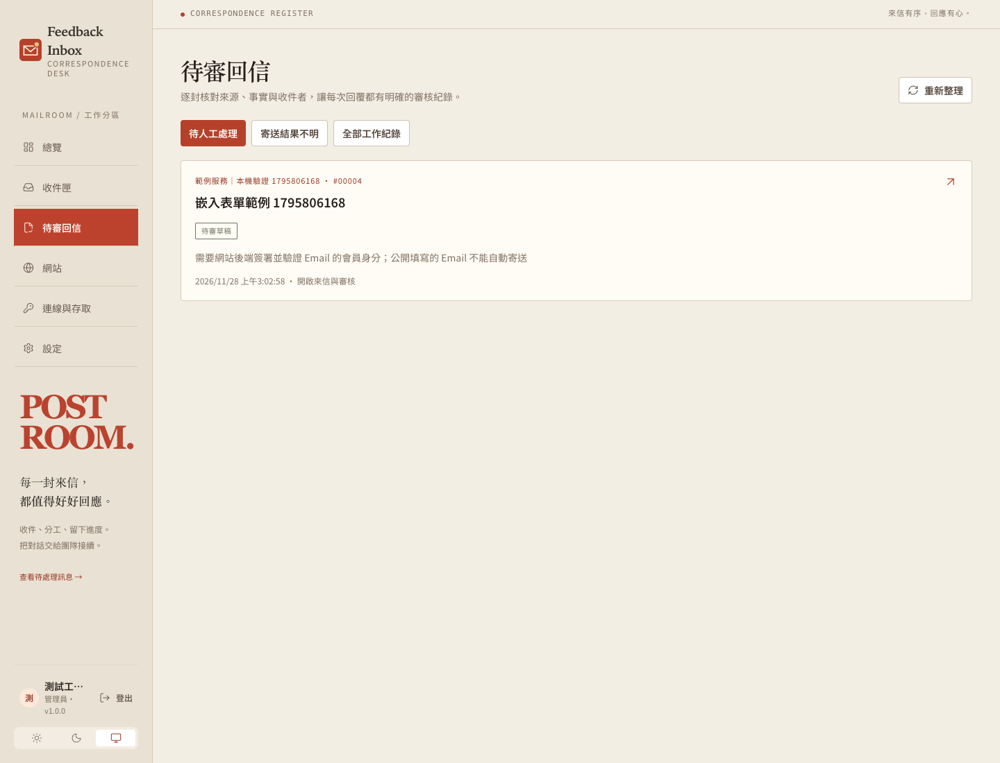

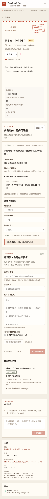
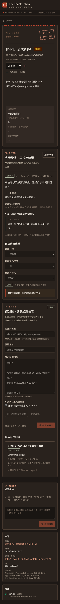

## Limits and review handoff

- OpenAI/Claude/Ollama adapters have local HTTP protocol fixtures; no live paid inference or installed real Ollama model was exercised. Operators must explicitly test their chosen model before site enablement.
- Redaction is limited, not a proof that free text has no personal data. Default export is empty and sensitive fields cannot be selected.
- Knowledge selection is the latest five approved entries, with a 20,000-character cap. Private notes, arbitrary prompt policies, explicit output-language overrides, embeddings and inbound email threading are not exposed.
- Auto replies require signed verified email and explicit consent, use fixed approved templates, and conserve quota on cancellation/failure. They never send model-authored freeform prose.
- Job records are observable; there is no arbitrary retry/dead-letter replay button. Unknown delivery requires human reconciliation, and no live external SMTP server was tested.
- Browser coverage is Chromium on the stated viewport sizes. It is not a cross-engine accessibility certification.
- Independent reciprocal review accepted `179193f`: the reviewer reran all 80 backend tests and strict Clippy, and independently verified the 58 frontend tests. The active-registration boundary and immutable confirmation snapshot are covered; no actionable blocker remained in the reviewed scope. Final container/browser receipts are recorded separately below.

To remove only this fixture after review, run `docker compose -p feedback-workflow -f docker-compose.yml -f docs/compose.forms-ai-test.yml --profile mail down -v`. This deletes only the named disposable project's volume; never apply that command to a production project.
