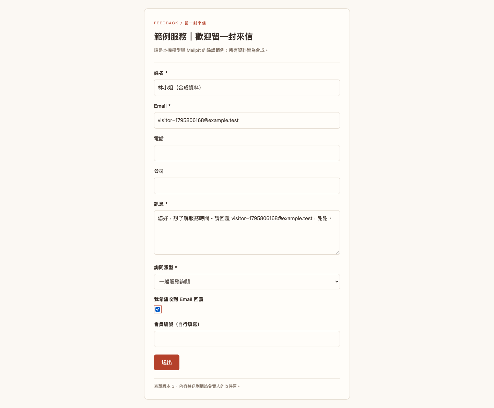
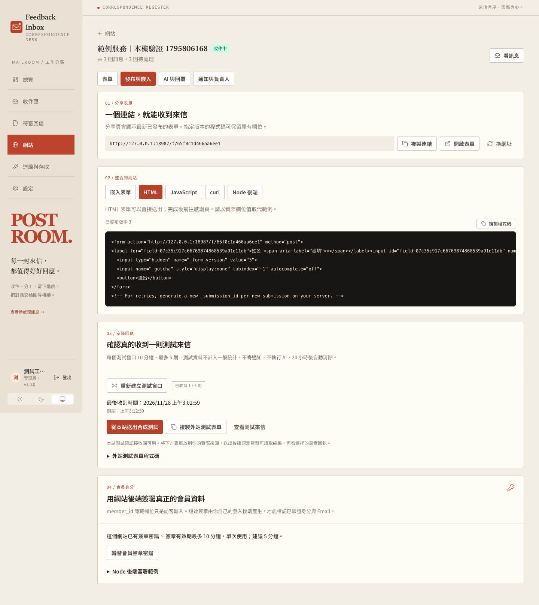
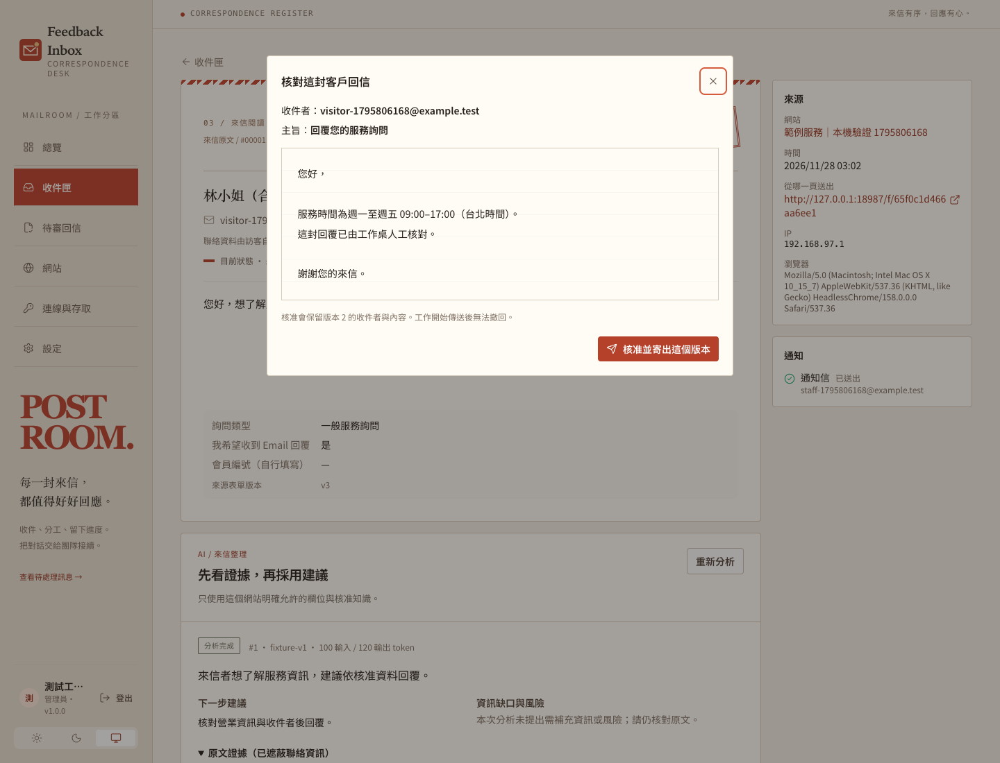
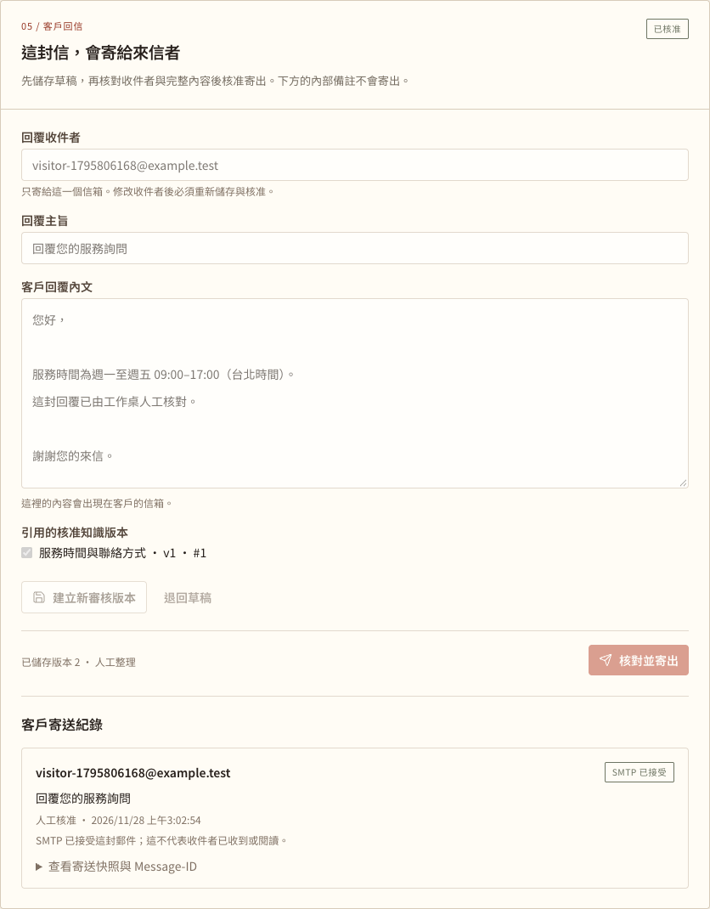

# 表單、AI 建議與客戶回覆

Feedback Inbox 的表單、收件匣與團隊備註可獨立使用。AI 預設關閉；產生建議、採用分類、儲存草稿和寄出回信是不同動作。SMTP「已接受」表示伺服器接受郵件，不代表收件者已收到或讀取。

## 操作實拍：發布、整合、核對、寄送

以下是隔離 Compose 經 nginx 執行的真實介面，使用合成訪客、本機 Ollama 協定 fixture 與 Mailpit。沒有呼叫付費模型或寄給外部客戶；模型內容是驗證用資料，不能據此判斷商用模型品質。

### 1. 發布表單，確認訪客看到的欄位

在「網站 → 表單」設定欄位並發布，再開啟現成連結檢查姓名、email、自訂選單及回覆意願。下圖是版本 3 的公開表單；會員編號即使有填寫，也只是訪客提供的資料，可信身分需依後面的後端簽章流程建立。

### 2. 選擇整合方式，驗證實際收件

到「發布與嵌入」複製連結或目前版本的程式碼。外站送出前設定精確來源；iframe 另設允許嵌入來源。開啟安裝測試後，確認後端真的收到測試來信。圖中的「已收到 1 / 5 則」是實際收件回執；從本站送出只能驗證本站路徑，外站仍要在自己的頁面測試。

### 3. 儲存草稿，再核對確切版本

產生 AI 建議後先讀原文引文，核對核准知識並編輯客戶回覆。按「儲存回覆草稿」，再按「核對並寄出」。對話框保留這一版的收件者、主旨與完整內文；版本或寄送狀態改變後，須關閉並重新核對。內部備註不會成為客戶回信。

### 4. 查看寄送結果，分清「接受」與「送達」

按「核准並寄出這個版本」後，在「客戶寄送紀錄」查看結果。下圖的人工回覆由 Mailpit 接受，並保留收件者與寄送快照；SMTP 接受不等於已送達或已讀。若顯示結果不明，先查核郵件服務，系統不會自動重寄。固定範本自動回覆另有明確開關與資格條件，見後面的操作說明。

更多桌面／手機、來源限制、受控自動回覆與程序重啟實測，見 [驗證紀錄與完整畫面](forms-ai-verification.md)。

## 發布與整合

在「網站 → 表單」加入 email、會員編號或自訂文字、長文字、數字、選單、勾選與隱藏情境欄位，儲存草稿後發布。每次發布留下不可變版本；來信以當時版本的標籤、選項與型別呈現。已發布欄位的名稱與型別不可原地變更，需新增欄位。每張表單最多 30 欄；輸入總大小上限 64 KiB，沒有附件功能。

「發布與嵌入」提供現成連結，以及從目前發布版本產生的 iframe、HTML、JavaScript、curl、Node 後端範例。範例包含 `_form_version` 與實際必填欄位，請以自己的值取代範例文字。舊版本在停用前仍能收件；停用後回傳 410。重送相同 `_submission_id`（16–80 個 ASCII 字元）與相同資料，在 7 天內只收件一次；同 ID 不同資料回傳 409。新的來信要產生新 ID。

- **分享連結／本站表單**：由 Feedback Inbox 的公開網址直接送出，不用設定跨來源權限。
- **瀏覽器 fetch 或其他網站的 HTML 表單**：在「通知與負責人」加入該網站的完整來源，例如 `https://www.example.com`，含非預設連接埠、無路徑。JavaScript 範例使用 `credentials: "omit"`，不需 API 金鑰。
- **iframe**：另外加入允許嵌入的來源。只有 `/f/:key/embed` 與其完成頁允許框架；登入、管理與 API 頁面仍禁止嵌入。iframe 自己送出表單，完成畫面留在框架內。
- **網站後端**：Node/curl 不受瀏覽器 CORS 限制，但整合方仍須驗證自己的登入與輸入。來源清單是瀏覽器控制，不是使用者身分驗證。

新網站使用精確來源模式，空清單只接受本站瀏覽器來源。升級前來源清單為空的網站保留明確標示的 `legacy_public`；管理員可改成精確模式。不要用 `no-cors` 隱藏錯誤，這會讓瀏覽器無法讀取收件結果。

管理員可開啟 10 分鐘的安裝測試，最多接收 5 則合成來信；畫面依後端實際收件更新時間與數量。測試 token 只放 POST body，測試資料不會通知、分析或回信，預設不列入收件匣、統計與匯出，超過 24 小時由背景清理移除。這項收件測試不能代替外部瀏覽器的 CORS／iframe 檢查。

## 可信會員身分

自行填寫或隱藏的會員編號始終是訪客提供的資料。若要驗證身分，管理員在整合頁產生一次顯示的網站簽章密鑰，由**自己的網站後端**保管；頁面提供 Node 範例。後端依真實登入狀態簽署 `{v:1, site_id, sub, email, email_verified, iat, exp, jti}`，用 `_identity_token` 放入 POST body。

簽章為 HMAC-SHA256，payload/signature 使用 base64url，最長有效期 600 秒（建議 300）、時鐘偏差 60 秒。每個網站的 jti 只可使用一次；相同收件識別碼的相同重送可回傳既有結果。簽章 token／密鑰不會回傳到來信資料或模型。旋轉網站密鑰立即使舊簽章失效。`email_verified: true` 必須代表整合後端已驗證該地址，不能照抄瀏覽器的值。

## 啟用可選 AI

先在部署環境設定 `FI_AI_SECRET_KEY`：以 `openssl rand -base64 32` 產生，與 SQLite 分開備份。這是加密保存供應商 API Key 與會員簽章密鑰的部署金鑰。遺失或替換錯誤會讓既有密鑰無法解密；一般收件仍可使用。

到「設定 → 管理 AI 供應商」新增：

| 供應商 | 設定 |
|---|---|
| OpenAI | OpenAI **Platform API Key**、支援所需結構化輸出的模型；固定 `https://api.openai.com`。不接受 ChatGPT/Codex 登入憑證。 |
| Claude | Anthropic API Key 與支援所需結構化輸出的模型；固定 `https://api.anthropic.com`。 |
| Ollama | 部署允許的來源與本機模型。Docker 連主機常用 `http://host.docker.internal:11434`，須明確加入 `FI_AI_ALLOWED_OLLAMA_ORIGINS`。 |

密鑰留白會保留原值；清除需明確勾選。已保存密鑰不會回傳給瀏覽器。啟用供應商後按連線測試：只送合成資料、最多 128 輸出 token、15 秒、一次嘗試；真實遠端測試可能計費。變更設定或密鑰會使先前測試失效。系統不自動呼叫其他供應商。

在「網站 → AI 與回覆」選擇模型及允許送出的欄位。預設沒有選取欄位，個人資料欄位要另外允許，敏感欄位、會員識別、回覆同意、IP、瀏覽器資訊、私密備註與密鑰不送出。已知姓名／email／電話／公司與常見 email、電話樣式會遮蔽；自由文字仍可能包含未被偵測的個人資訊。

設定分類、標籤與用量後，可手動分析或開啟收到新來信後產生建議。最新 5 筆仍由有效管理員核准的知識會提供給模型；只有這些知識可以支持 AI 草稿。編輯知識會產生新草稿版本、停用舊核准版本。沒有支持資料時保留資訊缺口，不自動補造政策。沒有爬蟲、向量索引、工具執行或模型瀏覽功能。

| 限制 | 預設／範圍 |
|---|---|
| AI 並行工作 | 全部署 2；`FI_AI_CONCURRENCY` 1–8 |
| 每網站每日嘗試 | UTC 100；1–1,000；重試也計數 |
| 單次時間／輸出 | 60 秒／1,000 token；5–120 秒／128–4,096 token |
| 選取輸入與知識總量 | 20,000 Unicode 字元，超量明確失敗，沒有靜默截斷 |
| 分類／標籤設定 | 各最多 30；分類至少 1 個 |
| 模型輸出 | 摘要、語言、分類、最多 10 標籤、低／一般／高優先程度、網站負責人、下一步、資訊缺口與風險、1–20 段原文證據、可選草稿 |

證據位置以送入模型的遮蔽後 Unicode 字元計算，逐段核對引用與範圍；分類、負責人、知識引用亦驗證。畫面只顯示這些建議和證據，不顯示模型思考過程。採用分類不會改變原本的未處理／處理中／已完成狀態。

## 人工回信與受控自動回覆

來信頁的「客戶回信」與內部備註分開。可手動寫信，也可編輯模型草稿。每次儲存留下新版本，內容未儲存不能核准；如果另一個版本抵達，保留正在輸入的內容並提示重新載入。核准對話框顯示確切收件者、主旨與內文。重複相同核准識別碼不會多寄一封。

自動回覆只寄**管理員核准的固定範本**，模型自由文字永遠留待人工審核。啟用需同時有部署 `FI_AI_AUTO_SEND_ENABLED=true`、SMTP、網站 AI 與網站自動回覆開關。規則由一個已發布 select 欄位的精確值、分類及核准範本組成；最多 20 條規則，多條符合會留待審核。規則試算只報告現有來信資格，不寄送。

全部條件必須在排程和傳送前成立：

1. 網站與核准者仍有效，供應商／政策／來源／知識／範本版本仍相同。
2. 是啟用之後的新來信，狀態未處理、未滿 24 小時，非測試／垃圾資料，尚無人類草稿介入或已拒絕草稿，未有既有客戶寄送。
3. 後端簽章證明該 email 已驗證，且表單的 `reply_requested` checkbox 已勾選。
4. 唯一精確規則符合；分析完成且無風險、資訊缺口或高優先程度。
5. 在原子配額內：每網站每日 UTC 預設 20 封（1–200）、同地址同網站 24 小時一次、每則來信一次。配額在排程時保留，取消或失敗不退還，以保守方式限制重試及重複操作。

無知識引用的範本只允許 UI 提供的標準收件確認，內容必須完全相同。其他範本要引用仍核准的知識。允許替換僅 `{site_name}`、`{reference}` 與允許分類 `{category}`；不插入來信自由文字。範本核准不是事實查核服務，管理員應自行核對內容與知識。

關閉或暫停會取消尚未傳送的自動回覆，已開始 SMTP 傳送者無法收回。重新啟用只處理之後的新來信；不補寄舊件。資格不足、供應商故障、額度耗盡或版本變更會顯示原因並留待人工處理。

## 工作與故障處理

收件與初始通知／分析工作同一交易落盤。工作每秒輪詢，180 秒租約、30 秒 heartbeat，最多 3 次嘗試；可重試的模型失敗採 5／30 秒加 0–2 秒抖動、Retry-After 最長 300 秒。站內「工作紀錄」顯示最近 100 筆工作及安全錯誤碼。可手動重新分析；沒有任意重放死信佇列的管理介面。

權限、來源與政策在模型呼叫前和結果寫入前重查。人工核准、暫停／取消和傳送邊界用 SQLite 寫入鎖序列化；網路 I/O 期間不持有交易。工作租約失效後，舊 worker 不能續租或提交結果。傳送邊界前丟失的回覆工作可安全重試；已進入 `sending` 的工作恢復為 `delivery_unknown`。

SMTP 明確拒絕可依暫時／永久錯誤處理；網路中斷、逾時或已開始傳送後的程序終止一律保守視為結果不明，**不自動重寄**。管理員查證 SMTP 記錄後，可在來信頁登錄「確認已寄出」或「確認未寄出」及理由；理由保存在內部備註，稽核保存其雜湊。確認未寄出後仍須建立新草稿版本與新的人工核准才能再寄。

稽核事件不可修改／刪除，保存操作者、版本／雜湊與結果，不複製郵件內容或密鑰。刪除網站／來信會依外鍵刪除其內容紀錄，最小稽核資料保留。現有 MCP 仍為明確允許的讀取操作；沒有新增模型或 MCP 自動寄信權限。

### 離線輪替部署加密金鑰

1. 停止 API，備份 SQLite 與目前加密金鑰，等待既有工作租約結束。
2. 保持舊 `FI_AI_SECRET_KEY`，另以安全環境注入 `FI_AI_NEW_SECRET_KEY`（新的 base64 32 bytes）。執行 `feedback-inbox rotate-ai-encryption-key`，或停止服務後用 Compose 一次性容器執行相同命令；不要把金鑰寫進命令列或版本控制。
3. 命令在單一交易重新加密所有供應商與網站身分密鑰；任何解密失敗整批回滾，有有效執行租約時拒絕。排程中的 AI／回信會取消，供應商測試失效。
4. 將部署 `FI_AI_SECRET_KEY` 換成新值、移除 `FI_AI_NEW_SECRET_KEY`，啟動服務並重新測試供應商。網站會員簽章內容不變，只有保存時的加密封套改變。若維護失敗，先還原相配的資料庫與舊金鑰再啟動。

[API 與前端合約](contracts/forms-ai-ui.md)記錄實際欄位與路由；[驗證紀錄](forms-ai-verification.md)說明本機 fixture 與 Mailpit 的測試範圍。
